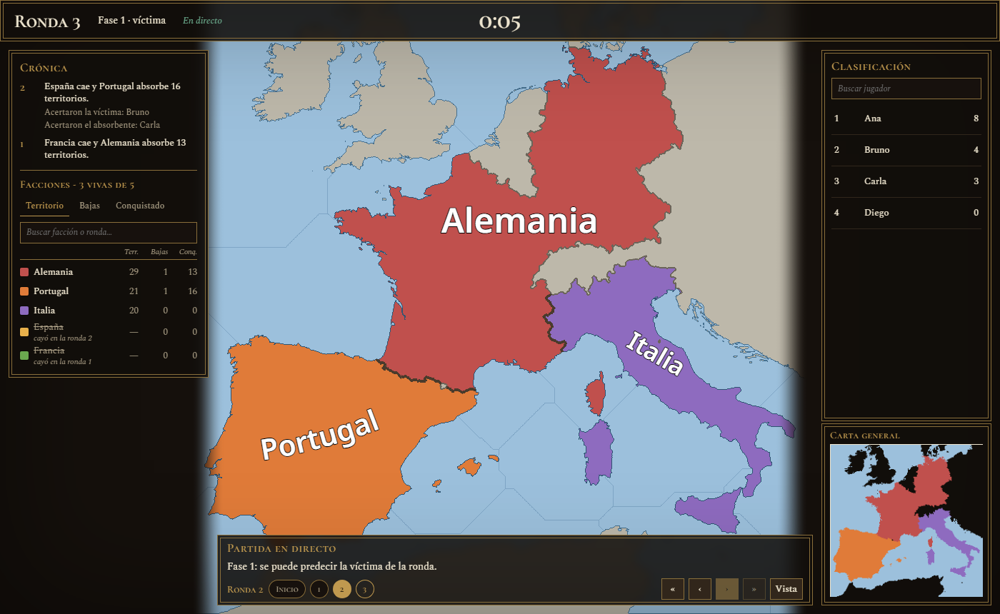
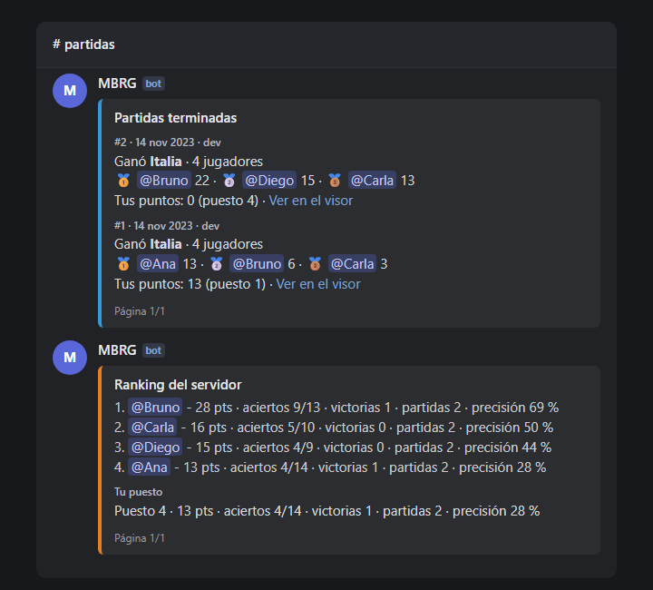
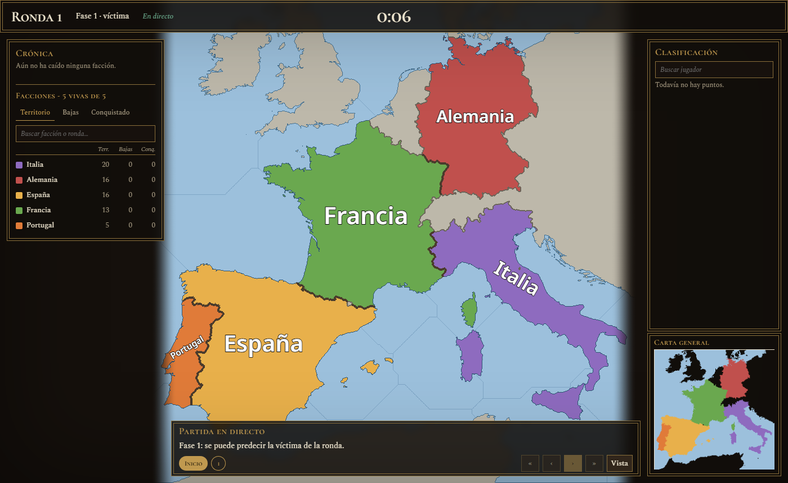
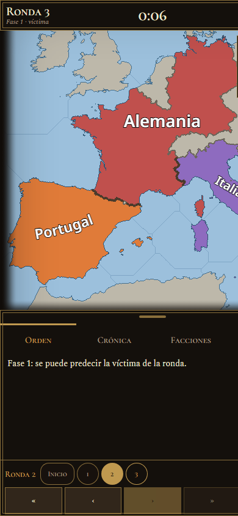

# FactionFall — Map Battle Royale

A **Battle Royale for EU4 / RISK-style maps**: every round one faction is
wiped out at random, and a neighbour swallows **all** of its provinces, until
only one is left standing.

The point isn't to play — it's to **spectate and predict**. A whole match is
decided by a seed, so the engine can replay it exactly; the server keeps that
seed secret and reveals the match one round at a time, so you can bet on what
happens next instead of watching a foregone conclusion.



## Status: `v0.3.0-alpha`

FactionFall is a full stack now, not just a viewer:

- ✅ **Deterministic engine** — the "Clásico" mode, same seed, same match, in
  the browser, the server, the bot and the tests.
- ✅ **Anti-spoiler game server** — matches are computed server-side and
  **future rounds never reach the client**. A match publishes a commitment up
  front and reveals its secret only once it is over.
- ✅ **Real matches with predictions** — each round has two phases (guess the
  victim, then guess who absorbs it), a forced-absorber case when only one
  neighbour is possible, and points for every right guess.
- ✅ **Discord bot** — `/ff create` opens a lobby, the channel follows the
  match live (one embed per round), members predict with buttons, and the
  bot keeps a **per-server history** (`/ff history`) and a **per-server
  ranking** (`/ff ranking`) in four orders: points, hits, wins and accuracy.
  The bot's interface is in Spanish.
- ✅ **Viewer** — WebGL map with round playback, chronicle, faction table,
  minimap, a live leaderboard and **spectator links** (`?match=…&spectate=1`)
  that the bot posts in the channel.
- 🚧 **In flight**: spec 027, ranking by time window (weekly / monthly) —
  **not shipped yet**.



*The embeds above come from the e2e harness (`npm run e2e -w @mbrg/bot`):
a scripted match against the real server with a simulated Discord, planted
player names, no real chat involved.*

### A note on spoilers

The server is what makes betting fair: it never sends a round that has not
happened yet. The **pure client-side viewer** (the static build, with no
server) is different: it computes the match in your browser from the seed in
the URL, so anyone with the link can work out the coming rounds. That is fine
for watching, and it is exactly why predictions only exist against the
server.

## How to follow a match

1. Run `/ff create` in a Discord channel (needs *Manage Channels*) and press
   **Start** when the lobby is ready.
2. Members press **Predict** and pick the victim, then the absorber, each
   round. Scoring: a right victim is worth the number of factions alive at
   that round, a right absorber the number of candidate absorbers.
3. Anyone opens the spectator link the bot posts to watch the map update.
   Playback controls let you review earlier rounds (and jump back to live).
4. When the match ends the bot posts the winner and the final leaderboard;
   `/ff history` and `/ff ranking` keep the server's record.



The viewer works on a phone too:



Controls: mouse wheel or pinch to zoom, drag to pan, the minimap in the corner
to jump around. The interface is in Spanish for now.

A [live demo](https://agarcial16.github.io/MBRG/) of the static client-side
viewer is on GitHub Pages (no server there, so no predictions).

## Running it locally

```bash
npm install       # install dependencies and link the workspace packages
npm run dev       # viewer dev server → http://localhost:5173
npm run build     # production build of the viewer (vite build)
npm test          # tests (vitest run, no build needed first)
npm run typecheck
npm run e2e       # scripted match + embed preview (HTML) in e2e-preview/
```

`npm run dev` talks to a game server on `http://127.0.0.1:8787` by default.
To run the real stack — game server, Discord bot and viewer, with credentials,
systemd and TLS — follow the **[deployment guide](docs/deployment.md)**.

## Structure

A TypeScript monorepo using npm workspaces. The same deterministic simulation
runs in the tests, the server, the bot and the browser.

| Path | What's in it |
| --- | --- |
| `packages/shared` | Map format (`MapFormatV1`), validation, adjacency, match types |
| `packages/sim` | The engine: `step()` (one round), `simulate()` (whole match), seeded PRNG |
| `packages/protocol` | Wire types and readers shared by the server, the bot and the viewer |
| `apps/web` | The viewer (Three.js / WebGL): playback, chronicle, leaderboard, spectator links |
| `apps/server` | The game server: matches, phases, predictions, scoring, history and ranking, SQLite store |
| `apps/bot` | The Discord bot: lobby, live channel follow, history and ranking embeds, e2e harness |
| `tools/build-map` | Offline map build: GeoJSON / PNG → `map.json` + `ids.png` |

## "Clásico" rules

Each round:

1. A living faction is picked **at random**.
2. Its candidate neighbours are those sharing a border with **any** of its
   provinces.
3. One of them takes **all** of its provinces.
4. Repeat until a single faction remains.

## Roadmap

| State | What |
| --- | --- |
| ✅ Done | Viewer · game server with predictions and anti-spoiler · Discord bot with per-server history and ranking |
| 🚧 In flight | Ranking by time window, weekly and monthly (spec 027) |
| ⏭️ Next big thing | **Map importer**: upload an image, turn it into a playable map |
| 🔭 Later | Viewer replay of finished matches · more game modes · 3D |

## License

[MIT](LICENSE) © 2026 Ángel García
